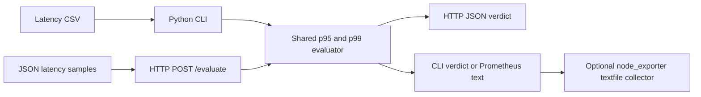

# API Latency SLO Sentinel

Evaluates API latency samples against p95 and p99 SLO thresholds.

Focus: Consumer-scale SRE observability.

Built as a small, runnable Python project with clear input, output, sample data, and tests.

## Run

```bash
python3 latency_sentinel.py sample_latency.csv
```

## Verify

```bash
python3 -m unittest discover . -v
```

## Local verification

Run `make verify` with Make and Python 3 installed. The target runs the documented sample through the project CLI. It also runs the existing Python unit tests.

## Prometheus metrics

Run `python3 latency_sentinel.py sample_latency.csv --prometheus` for Prometheus text exposition. The output includes p95 and p99 latency in seconds and a breach gauge (1 for breach, 0 for healthy). To collect a scheduled snapshot with a node_exporter textfile collector, redirect the command to a temporary file in the configured collector directory, then rename it to `api_latency.prom` after the command succeeds. The CLI evaluates one CSV snapshot per run.

## Business problem

During a rollout, engineers need a repeatable way to tell whether slow API
responses cross service targets. The Sentinel evaluates tail latency from a
batch of samples and returns a verdict that can be reviewed before continuing.

## Architecture and evidence



See the [data flow and architecture](docs/ARCHITECTURE.md), the
[case study](docs/CASE_STUDY.md), and [troubleshooting](docs/TROUBLESHOOTING.md).

## HTTP demo

Run `python3 api.py`, then submit a synthetic sample from another terminal.

```sh
curl --fail-with-body http://127.0.0.1:8080/evaluate \
  -H 'Content-Type: application/json' \
  -d '{"latency_ms":[120,180,240,990,1100]}'
```

Expected verdict is `breach` with p95 and p99 both 1100 ms.
`GET /healthz` checks server readiness.

## Deployment lab

Build and start the container with Docker.

```sh
docker build -t latency-sentinel:local .
docker run --rm -p 127.0.0.1:8080:8080 latency-sentinel:local
```

For kind, load the local image, apply the manifest, and forward the port.

```sh
kind load docker-image latency-sentinel:local
kubectl apply -f deploy/kubernetes/deployment.yaml
kubectl rollout status deployment/latency-sentinel
kubectl port-forward deployment/latency-sentinel 8080:8080
```

## Verification and limitations

`make verify` runs the CLI smoke checks and local HTTP tests. The container
and Kubernetes assets are provided for a separate deployment check.
A [GitHub Actions workflow template](docs/github-actions/ci.yml) is included.
The demo HTTP service is intended for local or isolated use. A batch verdict
is a snapshot, and the percentile estimate is coarse for small samples.

## Project walkthrough

[Observed CLI and API verification](docs/VERIFICATION.md)
