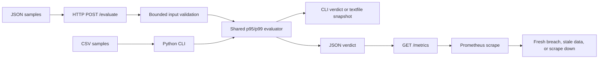

# API Latency SLO Sentinel

Evaluate a CSV or JSON batch against p95 and p99 latency thresholds, then
follow the decision through a Prometheus scrape and alert.

[Skills and verification](docs/ENGINEERING_NOTES.md)

## Business problem

Averages can hide slow requests during a rollout. An SRE reviewing a release
needs to see whether tail latency crossed its targets and whether the evidence
is fresh enough to act on. The Sentinel turns one batch into a reproducible
verdict and distinguishes stale inputs from an unavailable monitoring target.

## What I built

I built a shared Python evaluator for the CLI and HTTP API so a CSV batch and its JSON equivalent yield the same p95/p99 verdict. The API publishes the latest accepted result and outcome counters to Prometheus. The alert rules separate a fresh latency breach, a missing or stale batch, and a failed scrape. A synthetic 1,100 ms sample triggered the breach rule in a live local scrape.

## Architecture



[Architecture and data flow](docs/ARCHITECTURE.md) · [Case study](docs/CASE_STUDY.md) · [Operator runbook](docs/RUNBOOK.md)

## Technology stack

| Tool | Role |
| --- | --- |
| Python | Shared percentile evaluator, CLI, and HTTP API |
| Prometheus | Scrapes evaluation metrics and applies three alert rules |
| promtool | Checks the scrape configuration, metric format, and alert behavior |
| unittest | Covers CLI results and the HTTP contract |
| Make | Runs verification, replay, lint, and security checks |
| Ruff and Bandit | Lint and static security checks |
| Docker and Kubernetes | Container packaging and an isolated deployment example |

## Quick start

Run the CLI from a clean checkout with Python 3 and Make installed.

```sh
python3 latency_sentinel.py sample_latency.csv
python3 latency_sentinel.py sample_latency.csv --prometheus
```

Start the HTTP service with `python3 api.py`. From another terminal:

```sh
curl --fail-with-body http://127.0.0.1:8080/evaluate \
  -H 'Content-Type: application/json' \
  -d '{"latency_ms":[120,180,240,990,1100]}'
curl --fail http://127.0.0.1:8080/metrics
```

The response reports `breach` with p95 and p99 both 1100 ms. Metrics use
seconds. `GET /healthz` checks whether the evaluator can respond.

## Configuration and monitoring

The evaluator uses thresholds of 300 ms p95 and 750 ms p99. The HTTP server
binds to loopback on port 8080 by default. Run a local Prometheus instance
with `prometheus --config.file=deploy/prometheus/prometheus.yml`.
The [runbook](docs/RUNBOOK.md) explains how to inspect alerts, confirm a
recovery, and troubleshoot missing data.

## Testing and replay

```sh
python3 -m venv .venv
. .venv/bin/activate
python -m pip install -r requirements-dev.txt
make check PYTHON=python
make verify-monitoring PYTHON=python
```

The monitoring target requires `promtool` on PATH. Replay compares the
bundled fixtures to checked-in output and exits nonzero on a mismatch.

[Replay cases](examples/replay-manifest.json) · [Replay report](reports/replay.md) · [Verification results](docs/VERIFICATION.md) · [Rules](docs/RULES.md) · [Development and security checks](docs/DEVELOPMENT.md)

## Deployment lab

```sh
docker build -t latency-sentinel:local .
docker run --rm -p 127.0.0.1:8080:8080 latency-sentinel:local
```

For kind, stop the Docker demo first to free port 8080.

```sh
kind load docker-image latency-sentinel:local
kubectl apply -f deploy/kubernetes/deployment.yaml
kubectl rollout status deployment/latency-sentinel
kubectl port-forward deployment/latency-sentinel 8080:8080
```

## Security and limitations

The local API accepts JSON with at most 5,000 samples and a 64 KiB body.
The Kubernetes example disables service-account token mounting and uses a
non-root container. Keep the service on a trusted network. Public deployment
would require authentication, TLS, and request and concurrency limits.

Each evaluation covers a single batch. Small batches give coarse percentiles,
and restarts clear the last result. Send a batch at least once every five
minutes to keep the alert evidence fresh. Docker and Kubernetes assets are
included for a separate deployment check.
