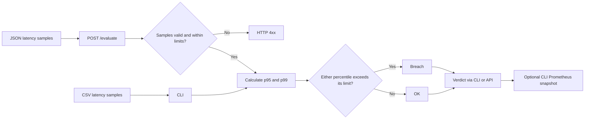

# Architecture

The evaluator sorts one batch of latency samples and compares p95 and p99
against 300 ms and 750 ms. The CLI preserves its original verdict and metrics
formats. The HTTP adapter validates a bounded JSON request before passing it
to the same evaluator. It stores no request data. The CLI metrics path emits
a snapshot that can be collected through node_exporter.

The HTTP server binds to loopback by default. The container is intended for an
isolated demo and listens on its container interface. The sample deployment
expects a locally loaded image and access through port forwarding.
