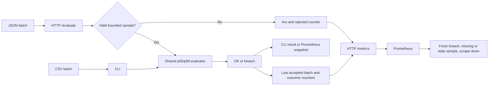

# Architecture

## Decision path

The evaluator sorts one batch of latency samples and compares p95 and p99
against 300 ms and 750 ms. Both entry points use the same evaluator. The CLI
can emit a one-shot snapshot for a Prometheus textfile collector. The HTTP API
validates the input before evaluation and keeps only the latest accepted
percentiles, verdict, timestamp, and three counters in memory.

Each request updates metric state under one lock so a scrape can observe a
consistent set of values. The metrics endpoint uses fixed outcome labels.
Invalid submissions increment the rejection counter and preserve the last
accepted result and its timestamp.

## Operating boundaries

Prometheus treats an accepted result as fresh for five minutes. At startup
the timestamp is zero and percentile gauges appear after the first accepted
evaluation. A failed scrape suppresses latency and freshness alerts. The
scrape-down alert waits one minute.

The HTTP service defaults to loopback. Docker and Kubernetes expose it for
an isolated deployment demo. For a live service, collect request distributions
continuously and establish sample volumes, SLO windows, and an alert policy
with the service owner.
